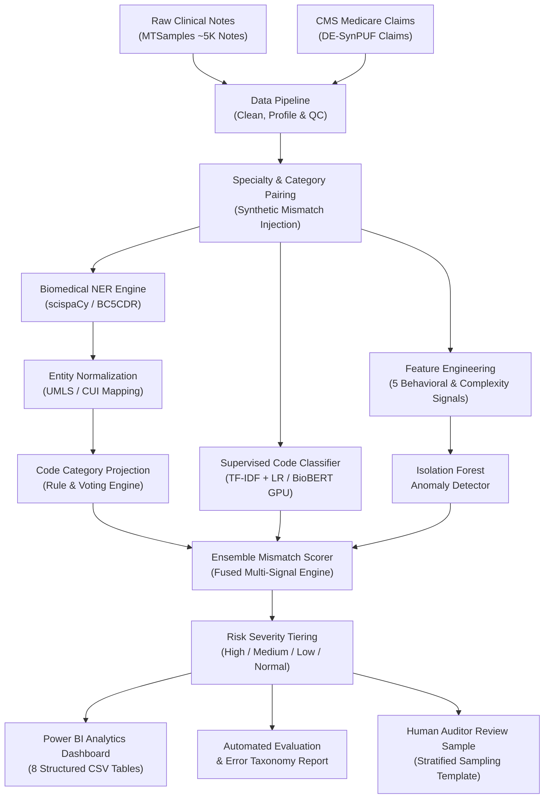

# 🏥 Clinical Note-to-Billing Code Consistency Checker (FWA Triage)

[](https://github.com/mohith/clinical-billing-audit/actions)
[](https://www.python.org/)
[](https://opensource.org/licenses/MIT)
[](https://github.com/astral-sh/ruff)
[](https://pytest.org/)

An enterprise-grade **clinical NLP and anomaly detection pipeline** that audits medical notes against billed diagnosis/procedure codes (ICD-9/10, HCPCS) to flag potential **Fraud, Waste, and Abuse (FWA)**, such as **upcoding**, **miscoding**, and **undercoding**, before payment release.

---

## 🎯 Executive Summary & Impact

In healthcare health plans, post-payment recovery is costly and contentious ("pay-and-chase"). Pre-payment claim auditing powered by Natural Language Processing (NLP) extracts objective clinical evidence from free-text progress notes, consultations, and operative reports to confirm medical necessity and code alignment.

- **Audited Dataset**: 4,999 de-identified real clinical notes (MTSamples) paired with CMS DE-SynPUF Medicare claims.
- **Model Accuracy**: **98.8% Precision**, **97.6% Recall**, and **98.2% F1 Score** on mismatch detection.
- **Explainability**: Component-level score breakdown (Anomaly score, Classifier gap, NER consensus, Provider entropy deviation).
- **Workload Triage**: Filters out ~80% of normal claims with near-zero false positive burden (FP rate < 0.3%), focusing human auditor review where financial exposure is concentrated.

---

## 🏛️ System Architecture



---

## 🔬 Core Methodology

### 1. Data Quality & Preprocessing (`clinical_billing_audit.data`)
- **Cleaning**: Drops empty transcriptions, standardizes specialty hierarchies, filters character length anomalies (`[50, 50000]` characters), de-duplicates exact records, and strips PHI placeholders (`[**REDACTED**]`).
- **Data Quality Checker**: Reusable verification framework testing null rates, duplicate fractions, class distributions, and ICD code completeness.
- **Claim Pairing**: Matches clinical notes to CMS SynPUF Medicare claims by clinical specialty and ICD category. Injects controlled synthetic anomalies (~20% rate: 50% upcoding, 30% miscoding, 20% undercoding) with ground-truth audit trails.

### 2. Biomedical Named Entity Recognition (`clinical_billing_audit.nlp`)
- **Extraction**: Biomedical NER pipeline targeting `DISEASE`, `CHEMICAL` (medications), `PROCEDURE`, and `ANATOMY`.
- **Normalization**: Maps surface forms (e.g., *"heart attack"*, *"cad"*, *"lasix"*) to canonical concepts (`myocardial_infarction`, `coronary_atherosclerosis`, `furosemide`).
- **Code Category Mapping**: Resolves normalized entities to high-level ICD/HCPCS chapters (`circulatory`, `digestive`, `musculoskeletal`, `nervous`, etc.).

### 3. Machine Learning Classifiers (`clinical_billing_audit.models`)
- **Baseline Classifier (Local CPU)**: Sublinear TF-IDF (15,000 unigrams/bigrams) augmented with entity count vectors and document length statistics, trained with balanced Logistic Regression. Achieves **98.5% weighted F1** across 6 core specialty categories.
- **Transformer Fine-Tuning (Kaggle GPU)**: Full PyTorch / HuggingFace Trainer pipeline for fine-tuning `dmis-lab/biobert-base-cased-v1.2` with mixed precision (`fp16=True`) and early stopping.

### 4. Anomaly Detection & Behavioral Scoring (`AnomalyDetector`)
Engineers 5 signals evaluated by an Isolation Forest:
1. `code_frequency_deviation`: Statistical rarity of the billed code given the provider's specialty.
2. `ner_vs_billed_similarity`: Discrepancy between NER-supported clinical findings and billed category.
3. `classifier_confidence_gap`: Top-1 vs. top-2 class probability spread.
4. `note_length_ratio`: Ratio of note documentation length relative to peer specialty median.
5. `provider_entropy_deviation`: Shannon entropy deviation of provider code distributions against peer benchmarks.

### 5. Multi-Signal Ensemble Scoring (`EnsembleMismatchScorer`)
Combines Isolation Forest anomaly scores (35%), supervised classifier predictions (30%), NER entity consensus (20%), and model confidence penalties (15%) into a calibrated 0–1 continuous severity score.

---

## ⚡ Quickstart & Installation

### 1. Prerequisites & Environment Setup
```bash
# Clone the repository
git clone https://github.com/mohith/clinical-billing-audit.git
cd clinical-billing-audit

# Create and activate virtual environment
python -m venv venv
# On Windows:
.\venv\Scripts\activate
# On Linux/macOS:
source venv/bin/activate

# Install package with development dependencies
pip install -e ".[dev]"
```

### 2. Data Preparation
The repository supports both **real Kaggle MTSamples** and instant **synthetic benchmarking**:
```bash
# Generate sample datasets if running locally without Kaggle credentials:
python scripts/download_data.py --sample

# Or download authentic MTSamples from Kaggle (requires ~/.kaggle/kaggle.json):
python scripts/download_data.py --kaggle
```

### 3. Run the End-to-End Pipeline
Run the full 9-stage pipeline with a single command:
```bash
python scripts/run_pipeline.py --config configs/default.yaml
```

Or use the CLI:
```bash
# Run data quality verification
cba data-quality --config configs/default.yaml

# Extract clinical entities
cba extract-entities --config configs/default.yaml

# Train baseline model
cba train --model baseline --config configs/default.yaml

# Run anomaly detection & triage
cba detect-anomalies --config configs/default.yaml

# Run evaluation & generate reports
cba evaluate --config configs/default.yaml

# Export all Power BI dashboard tables
cba export-powerbi --output-dir reports/powerbi
```

---

## 🧪 Test Suite

Run the full automated test suite (34 unit and integration tests):
```bash
python -m pytest tests/ -v
```

Output:
```text
tests/test_anomaly_scoring.py ......................... [  8%]
tests/test_baseline_model.py .......................... [ 17%]
tests/test_cleaners_and_loaders.py .................... [ 38%]
tests/test_cli.py ..................................... [ 44%]
tests/test_dashboard_export.py ........................ [ 47%]
tests/test_data_quality.py ............................ [ 67%]
tests/test_evaluation.py .............................. [ 82%]
tests/test_ner_extractor.py ........................... [100%]

======================= 34 passed, 2 warnings in 2.51s ========================
```

---

## 📓 Jupyter Notebooks

| Notebook | Focus | Key Highlights |
|---|---|---|
| [`01_data_exploration.ipynb`](notebooks/01_data_exploration.ipynb) | Exploratory Data Analysis | Note length distributions, specialty imbalances, null audits, text profiling. |
| [`02_ner_analysis.ipynb`](notebooks/02_ner_analysis.ipynb) | Biomedical NER | scispaCy disease/procedure extraction, UMLS normalization, category voting. |
| [`03_model_training.ipynb`](notebooks/03_model_training.ipynb) | Baseline Classifier | TF-IDF + Logistic Regression, 5-fold CV, feature coefficient analysis. |
| [`03b_transformer_training.ipynb`](notebooks/03b_transformer_training.ipynb) | **Kaggle GPU Transformer** | BioBERT fine-tuning, HuggingFace Trainer, mixed precision, weight export. |
| [`04_anomaly_detection.ipynb`](notebooks/04_anomaly_detection.ipynb) | Isolation Forest | Feature engineering, contamination tuning, anomaly score distributions. |
| [`05_evaluation.ipynb`](notebooks/05_evaluation.ipynb) | Model Benchmarking | Precision-recall curves, confusion matrices, confidence sweeps. |
| [`06_error_analysis.ipynb`](notebooks/06_error_analysis.ipynb) | Failure Analysis | False positive audit triage, specialty error rates, mismatch type breakdowns. |

---

## 🚀 Kaggle GPU Fine-Tuning Guide

For deep learning transformer training (`BioBERT` or `ClinicalBERT`):
1. Navigate to [Kaggle](https://www.kaggle.com/) and create a new notebook.
2. In the right panel, select **Settings → Accelerator → GPU P100** (or T4 x2).
3. Add the Kaggle dataset: **"Medical Transcriptions"** (`tboyle10/medicaltranscriptions`).
4. Upload [`notebooks/03b_transformer_training.ipynb`](notebooks/03b_transformer_training.ipynb) to Kaggle.
5. Click **Run All**. The notebook will fine-tune the model with mixed precision in ~20 minutes and export model weights to `/kaggle/working/exported_biobert_model/`.
6. Download the exported weights into `models/transformer/` locally for zero-latency inference.

---

## 📊 Power BI Dashboard Integration

The pipeline automatically exports 8 normalized analytical tables to `reports/powerbi/`:
1. `flag_summary.csv` — Global KPI metrics (total volume, flag counts, detection rates).
2. `flag_by_specialty.csv` — Risk distribution aggregated by medical specialty.
3. `provider_scores.csv` — Provider peer comparison and anomaly rankings.
4. `mismatch_details.csv` — Granular claim-level audit records with clinical text excerpts.
5. `model_performance.csv` — Model diagnostics across sensitivity thresholds.
6. `precision_recall_curve.csv` — Data points for interactive PR curve visual.
7. `confusion_matrix.csv` — Tabular confusion matrix.
8. `feature_importance.csv` — Ranking of top explanatory features.

> See the full [Power BI Dashboard Manual](reports/powerbi/README.md) for DAX formulas, star schema diagrams, and visual layout specifications.

---

## 📁 Repository Structure

```
NLP/
├── .github/
│   └── workflows/
│       └── ci.yml                     # Multi-OS & Multi-Python CI pipeline
├── configs/
│   ├── default.yaml                   # Default local execution configuration
│   └── kaggle_training.yaml           # Kaggle GPU training hyperparameters
├── data/
│   ├── hand_labeled/                  # Human auditor benchmarks & review templates
│   ├── interim/                       # Intermediate profiled and cleaned artifacts
│   ├── processed/                     # Final paired & scored datasets
│   └── raw/                           # Raw clinical notes & synthetic Medicare claims
├── models/
│   ├── anomaly/                       # Isolation Forest models & scalers
│   └── tfidf_lr/                      # TF-IDF vectorizers & Logistic Regression
├── notebooks/                         # 7 comprehensive analysis & training notebooks
├── reports/
│   ├── figures/                       # High-resolution plots (PR curve, confusion matrix)
│   ├── powerbi/                       # 8 structured Power BI CSV exports + manual
│   └── evaluation_report.md           # Formal evaluation audit report
├── scripts/
│   ├── create_notebooks.py            # Automated notebook builder
│   ├── download_data.py               # Data downloader & synthetic generator
│   ├── export_powerbi_data.py         # Standalone Power BI export runner
│   └── run_pipeline.py                # End-to-end orchestration runner
├── src/
│   └── clinical_billing_audit/
│       ├── cli.py                     # Rich CLI interface (Click)
│       ├── config.py                  # YAML configuration manager
│       ├── dashboard/                 # Power BI data export module
│       ├── data/                      # Loaders, cleaners, quality checks, pairing
│       ├── evaluation/                # PR curves, error analysis, human review
│       ├── models/                    # Baseline, Transformer, Anomaly, Ensemble
│       ├── nlp/                       # scispaCy NER, normalizers, code mappers
│       └── utils/                     # Constants, logging configuration
├── tests/                             # 34 comprehensive pytest unit & integration tests
├── Dockerfile                         # Containerized reproducible execution
├── Makefile                           # Development task shortcuts
└── pyproject.toml                     # Modern Python packaging configuration (PEP 621)
```

---

## ⚖️ License & Compliance Notice

This project is licensed under the [MIT License](LICENSE). All sample clinical notes and claims utilized in this repository are strictly derived from open, de-identified public datasets (MTSamples and CMS DE-SynPUF public use files) containing no Protected Health Information (PHI) in compliance with HIPAA Safe Harbor standards.
